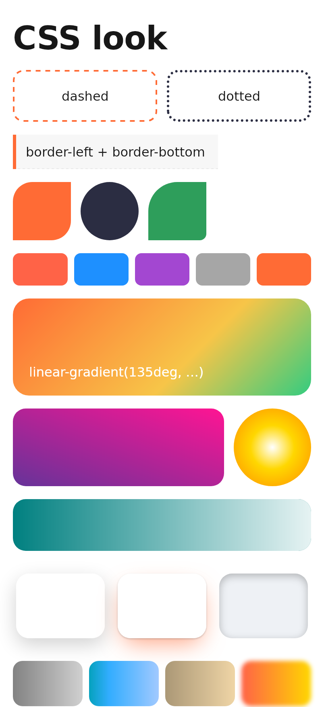

# Milestones

Work happens strictly in order. A milestone is done only when its exit
criteria are met and `cargo fmt --check`, `cargo check` and `cargo test`
all pass.

| # | Milestone | Status |
|---|---|---|
| M0 | Inspect, decide, document | **Done** (syntax approved 2026-11-21) |
| M1 | `era new`, `era.toml`, project discovery, `era check` (structure) | **Done** |
| M2 | Lexer, parser and AST with spans; parser tests | **Done** |
| M3 | Skin tokens, semantic checks, UI IR, asset validation | **Done** |
| M4 | Preview from the UI IR | **Done** |
| M5 | Kotlin/Compose codegen, Android host project, debug APK | **Done** (owner verified on a phone, 2026-11-21) |
| M6 | Button events, minimal state, navigation | **Done** (owner verified on a phone, 2026-11-21) |
| M7 | ERA Studio editor (Rust/egui): code editor + live preview, macOS (scope change D-065) | **Built and tested on Linux; Mac test pending** |
| M8 | CSS-familiar styling (D-071/D-080, `docs/CSS_SPEC.md`), phases | **Phase 1 done** (names, units, sizing, margin, positioning). Next: P3 borders, P4 paint |

## M0 deliverables

- Rust workspace with an `era` CLI stub (`crates/era_cli`)
- `CLAUDE.md`, `DECISIONS.md`, `MILESTONES.md`
- `docs/GRAMMAR.md`, `UI_SPEC.md`, `SKIN_SPEC.md`, `ERA_SPEC.md`, `ANDROID_BACKEND.md`
- `examples/showcase/`: a draft example in the proposed syntax. It is
  **not yet checked by any tool**.

## Planned crate split (created only when needed)

| Crate | Introduced | Contents |
|---|---|---|
| `era_cli` | M0 | The `era` binary and argument handling |
| `era_project` | M1 | `era.toml`, project discovery, asset path resolution |
| `era_diagnostics` | M1 | Spans, error codes, terminal rendering |
| `era_syntax` | M2 | Lexer, parser, AST |
| `era_ir` | M3 | Skin tokens, semantic analysis, UI IR |
| `era_codegen_compose` | M4/M5 | UI IR → Kotlin/Compose (shared by preview and Android) |

The brief's separate `era_lexer`, `era_parser`, `era_ast`, `era_ui` and
`era_skins` crates are merged into `era_syntax` and `era_ir` until a real
boundary appears.

## M1 deliverables

- `era new <name>` writes `era.toml`, `src/app.era` and `.gitignore`. It
  validates the name and refuses to overwrite a folder that is not empty.
- `era.toml` is validated (name, id, version, edition, `android.min_sdk`),
  and every error is reported with its line and column.
- `era check [path]` finds the project root by walking up from the given
  folder. It requires `src/app.era`, sorts files into UI, skin, logic and
  asset files, and warns about misplaced files, unknown extensions and
  mis-cased folders.
- Asset path resolution (`era_project::assets::resolve_asset`) is ready for
  M3. It rejects absolute paths and `..`.
- Diagnostic codes are listed in `docs/DIAGNOSTICS.md`.

Known limitations:
- `era check` does not read `.era` or `.ers` contents beyond checking that
  they are valid UTF-8. Syntax checks arrive in M2.
- Output has no colour.
- `era new` takes a folder name; the `id` defaults to `dev.era.<name>`.

## M2 deliverables

- The `era_syntax` crate:
  - a lexer producing typed tokens (strings with escapes, `#RRGGBB(AA)`
    colors, signed numbers) with byte spans
  - a recovering recursive-descent parser for the uniform node grammar
  - an AST in which every node keeps its source span
  - structural checks (D-027)
- An asset reference collector (`image`/`icon` literal paths), ready for
  M3 validation.
- `era check` now parses every `.era` and `.ers` file, runs the
  structural checks, and prints a declaration summary.
- Friendly errors for the brief's original draft syntax (`use skin`, a
  screen nested in `app`).
- Diagnostic codes E1001–E1218 are documented in `docs/DIAGNOSTICS.md`.

Known limitations:
- Property names, token names and value types are not validated yet. For
  example, `gapp: md` passes M2 and is caught in M3.
- `start: Home` is not yet checked against the declared screens (M3).
- Asset files referenced in source are not yet checked to exist (M3).
- If `era.toml` is invalid, source files are not parsed in that run. Fix
  the manifest first.

## M3 deliverables

- The `era_ir` crate:
  - typed skins merged across files, with validation of sections, value
    types, required colors, the `body` style, light/dark parity, weights
    and font files
  - the built-in default skin (D-020)
  - a property table for every primitive (`schema.rs`)
  - token lookup by property type, with "did you mean" suggestions
  - component and layout expansion with props, variants (`when`) and
    slots
  - asset existence and type checks
  - the platform-independent UI IR (`ir.rs`), in which every element has
    stable ids and an origin chain, and default values are resolved
- `era check` builds the IR and prints a summary. `era check --ir` prints
  the full resolved tree.
- The showcase gains image and icon examples (`Assets/Images/hero.png`,
  `Assets/Icons/star.svg`).
- A snapshot test of the showcase IR, regenerated with
  `UPDATE_SNAPSHOTS=1 cargo test`, plus a determinism test.
- Diagnostic codes E2001–E2152 are documented.

Known limitations:
- Dark mode is parsed and validated, but which mode applies, and when,
  is for the backends (P1).
- SVG icons are only checked to exist and to have the right extension.
  Converting them to native vectors is Q-03, due in M5.
- Navigation, events and state are not part of the IR yet (M6).
- Text styles are not checked against the fonts' actual weights.

## First demo: E-Renty (after M3)

`examples/erenty/` contains four screens built from the owner's mockups:
Splash, Home, Menu and Verify code. It has 4 screens, 11 components,
1 layout, 21 assets and 187 UI elements, and `era check` passes with no
errors. Its IR is snapshot-tested (`crates/era_ir/tests/snapshots/erenty.ir`).

Building it found and fixed two problems (D-039 and an error-message
article). It also raised open questions Q-07 to Q-11 (gradients, rich
text, overlap, dashed lines/italics, safe areas) and the proposal D-041
(`fill` along the main axis), which M4 needs.

`Quick_start_guide.md` walks a new user from install to a checked
project. Every step was run on a fresh install.

## M4 deliverables

- The `era_codegen_compose` crate turns the UI IR into Kotlin + Compose
  (foundation only). It generates the theme (light and dark palettes,
  dimension tokens, text styles, fonts), a runtime, a screen registry, and
  one composable per screen. Output is deterministic and
  snapshot-tested.
- `platforms/desktop-preview/`: the Compose Multiplatform Desktop host,
  with the asset host API (D-044), a PNG renderer and a preview window.
- `era preview [path]` opens a window. `era preview [path] --png [dir]`
  renders every screen (and dark variants) to 804 × 1748 PNGs without a
  display.
- The **E-Renty demo renders**: `docs/images/erenty-preview.png`. It was
  compared side by side with the mockups. Fixes found while doing this
  are D-043 (the root fills the screen) and the demo tuning, and the
  Inter font is now bundled (D-049).
- Tests: codegen unit tests, Kotlin snapshots for both examples, and CLI
  tests (argument errors, refusing invalid projects, the display check,
  a missing Gradle, stale-file removal). There is also a real Gradle smoke
  test, `cargo test -p era_cli -- --ignored`, which passed in the dev
  container.

Known limitations:
- The preview **window** could not be tested here, because the container
  has no display. Only the `--png` path was run.
- Buttons have no click handling, and nothing navigates (M6).
- `divider` is horizontal only. `gap` is ignored with
  `distribute: between/around/evenly`.
- Font weights are guessed from file names (`Inter-SemiBold.ttf` → 600).
- The first `era preview` downloads Kotlin and Compose (about a minute
  in the dev container). No Gradle wrapper is shipped, so Gradle 8.x must
  be installed.
- Remaining visual gaps against the mockups are the open questions
  Q-07 to Q-11 (gradients, rich text, overlap, dashed lines, safe areas).

## M5 deliverables

- `platforms/android/`: a single-module Android host (AGP 8.9.3, SDK 35,
  edge to edge, platform theme) that shows the start screen. It implements
  the Android `eraImage`/`eraIcon`/`eraFontFamily` (D-044, D-053).
- An SVG → VectorDrawable converter in Rust (D-051), with clear errors for
  unsupported SVG features (E3001).
- Generated Android resources: icon drawables, `EraIconIds.kt` and
  `strings.xml` (the app name).
- Safe-area handling on the screen root (D-050), shared with the preview.
- `era build android [path]` writes `build/android/` (incremental, with
  stale files removed), runs `gradle assembleDebug`, and prints the APK
  path plus `adb` install and launch commands.
- **The E-Renty APK builds** (8.1 MB). It was checked with `aapt2` and
  `apksigner`:
  - package `dev.era.erenty`, label "E-Renty", target SDK 35,
    `MainActivity` as the launcher
  - all 9 images and 4 fonts in `assets/`, and 12 vector icons in `res/`
  - the four screen classes compiled
  - signed with the debug key
- Tests: SVG converter unit tests, Android generator unit tests, and CLI
  tests (missing SDK, the generated project's contents, an unsupported
  icon error). There is also a real APK smoke test, run with
  `cargo test -p era_cli -- --ignored`, which passed.

Exit criteria status: **"installable Android app with the expected
visual appearance" is not fully verified.** The APK is built, signed and
structurally correct, but it has not been installed or launched, and its
on-device appearance has not been seen (Q-06). This needs the owner's
device:

```bash
adb install -r examples/erenty/build/android/app/build/outputs/apk/debug/app-debug.apk
```

```bash
adb shell am start -n dev.era.erenty/dev.era.erenty.ui.MainActivity --es era.screen Home
```

Known limitations:
- No launcher icon (Q-12, resolved in M9). Debug builds only (D-055, release builds added in M9).
- Only the start screen is shown until navigation (M6). Use `era.screen`
  to open the others (D-054).
- The Android SDK was installed by hand in the dev container
  (`/opt/android-sdk`). A fresh container needs it installed again.

## M6 deliverables

- Language: `store` blocks in `.er` logic files, with typed `state` and
  `action`s (`set`/`toggle`/`add`). In the UI: `on_press`, `visible` and
  `bind`; `go Screen`, `back` and `Store.action` chained with `then`;
  `{Store.field}` text interpolation; and the `action` prop type.
- Syntax, structure, IR and diagnostics (E1109–E1110, E2160–E2173), all
  with "did you mean" suggestions.
- Codegen: `EraStores.kt` (Compose state objects), `EraNav`, `EraApp`,
  `clickable`, conditional rendering, bound inputs, string templates.
- Hosts: the desktop window navigates for real. Android uses `EraApp`
  plus `BackHandler`. There is a desktop scripted-tap test hook (D-064).
- Demos:
  - **E-Renty** is a working flow: Splash → Home → Menu → Verify code →
    Verify, after which the verification prompts disappear, and Sign out
    resets the session.
  - **Showcase** gained a counter, a bound name input and a toggle.
- Tests: parser, structure, IR state/action tests, codegen tests, and 4
  real-Gradle smoke tests. These include a **headless tap-through of
  E-Renty in generated Compose code** (Splash → Home → Menu → VerifyCode
  → Menu) and a full E-Renty APK build.

Known limitations:
- No expressions in UI files (no `not`, no comparisons). Use a second bool
  state (E-Renty uses `needs_verification`).
- Variants cannot follow state yet (for example `tone: disabled` while a
  code is empty).
- State is not saved across app restarts (D-062).
- The on-device check of the APK is still pending (Q-06).

## M7 deliverables (ERA Studio, see docs/STUDIO.md)

- The `era_studio` crate and the `era-studio` binary (egui 0.37):
  - project tree
  - tabbed editor with ERA syntax colouring (colour swatches, error
    underline) and line numbers, with no wrapping
  - live Problems as you type, with click-to-jump
  - Output log
  - preview pane (real Compose renders, follows the edited screen,
    dark toggle) and Skin panel
  - Save (Cmd+S), Render (Cmd+R), Build APK, render on save
  - welcome screen with a native folder picker and New project
- `era_ir::pipeline` is now shared by the CLI and Studio (D-067).
- Tests:
  - workspace tests (live analysis of unsaved text, char-accurate jump
    targets, save, tree)
  - syntax colouring tests
  - 4 headless UI tests driving the real window, which enforce
    accessibility names and catch missing glyphs
  - a wgpu screenshot test (`docs/images/era-studio.png`)

Known limitations: no find/replace, autocomplete or undo history beyond
the editor's own, no hot reload, and no `.app` bundle yet. **Not yet run
on the owner's Mac.**

## M8 progress (CSS-familiar styling, D-080: the MVP follows HTML/CSS)

**Phase 1 (done):**
- every spelling of property names, plus CSS aliases
- CSS units (`px`, `%`, `fr`, `vw`/`vh`, `rem`/`em`, `pt`) and CSS keyword
  spellings
- every sizing mode
- `margin` (including `auto`), and the `padding`/`border`/`inset`
  shorthands
- `position` relative/absolute/fixed with offsets, `z-index`
- `opacity`, `visibility`, `display: none`, `overflow`, `aspect-ratio`
- `flex`, `align-self`, `flex-direction`, `flex-wrap`
- `;` separators

**Phase 3 (done, D-087):** `border-style` (dashed, dotted), per-side
borders, `border-width/-color/-style` with 1–4 values, per-corner and `%`
radius, `outline` with `outline-offset`. Verified by tests and the
showcase `Look` screen in the Compose preview. Limit: per-side borders
draw square corners.

**Phase 4a (done, D-088):** named colours, `rgb()`/`hsl()`, `var()`,
linear and radial gradients, background layers. Verified by tests, the
`Look` screen and an APK build.

**Phase 4b (done, D-089):** real `box-shadow` (layered, coloured, inset)
and `filter` (blur and colour filters), with no Compose version change.
Verified by tests, the `Look` screen and all 6 Gradle smoke tests.



**Verification:** the showcase gained a `Layout` screen. E-Renty's + button
is now raised with `position: relative` (fixes Q-09).

**Cheatsheet:** `docs/V2_SYNTAX_CHEATSHEET.md` is the owner's v2 input
sheet.

**Known limits:**
- percentage offsets (`top: 10%`) aren't supported yet
- in a row, `stretch` doesn't equalise heights
- `fixed` elements inside a `visible:` condition ignore the condition

## M9 deliverables (production Android: `era export android`, D-082–D-084)

- `platforms/android/` now has the standard Android Studio layout: an
  `app/` module, a version catalog and the Gradle 8.14.3 wrapper.
  `era build android` uses the same layout.
- `era export android [path] [--out dir] [--force]` writes a standalone
  project (default `export/android`): wrapper, `.gitignore`, a
  `README.md` with build steps, `local.properties` when the SDK is found,
  and Kotlin with export headers and no internal IR ids.
- Overwrite safety: a non-empty folder is refused (E3003). `--force`
  replaces only a folder with an earlier export's `.era-export` marker.
- `era export ios` explains that SwiftUI output is planned (D-082).
- **Verified (export):** the exported E-Renty project builds a debug APK with its
  own `./gradlew assembleDebug` (smoke test
  `exported_project_builds_with_its_own_gradle_wrapper`). All 5 Gradle
  smoke tests and 227 workspace tests pass.

**Release builds and app icon (D-085, D-086):**
- `era build android --release`: a signed, R8-optimised APK and an App
  Bundle for Google Play. E-Renty: 1.7 MB release APK (debug: 8.2 MB).
- `app { icon: "Images/app_icon.png"; icon-background: primary }`:
  launcher icons for every density, plus an adaptive icon.
- Verified by `release_build_smoke_test`: `apksigner` shows the release
  certificate, and `aapt2` shows the icon and a non-debuggable app.

Known limits:
- An export is a snapshot. Re-exporting replaces hand edits.

## Data, steps 1–2 (owner-approved, D-090, D-091)

- `persist state` keeps store values on the device (SharedPreferences);
  the showcase counter survives restarts.
- `Data/*.json` mock data lists and `for p in Products { ... }`, with
  `p.field` in text, images, icons and `visible`. The showcase `Menu`
  screen lists `Data/products.json`.
- Verified by parser, IR and codegen tests, the preview render, all 6
  Gradle smoke tests and a showcase APK build.
- Not yet: real network APIs, forms, sorting/filtering lists.

## M10 plan: ERA Studio visual builder (D-092, owner order)

1. Language gaps first: data items in components (done, D-093), P5 text
   styling (done, D-094; `span` rich text still open), P4c effects
   (`clip-path`, blend modes, background images).
2. Canvas (done, first version, D-095): **Era Builder** (`era-builder`),
   a separate app. `era_canvas` lays out every screen with Taffy; click to
   select, scroll/pinch to pan and zoom, device sizes.
3. Layers and properties panels that rewrite `.era` source precisely
   (done, first version): CSS fields, colour pickers, every property in
   the code, component props, labels.
4. Direct manipulation: drag from the Insert palette, drag to move on the
   canvas and in layers, delete, undo/redo, add screens (done). Still to
   do: resize handles, inline text editing, moves across files.
5. Design-system tools: components/variants, skin tokens, device frames,
   screen links.
6. Export delivers native code (owner): Kotlin/Compose (done) and SwiftUI
   (D-082; verified on the owner's Mac with Xcode).

## Next smallest task

1. M8 phase 3–4: borders, corners, colour functions, gradients,
   `box-shadow`, filters (owner: "build everything the HTML/CSS way").
2. Then, by owner priority: a `.app` bundle with an icon, find/replace,
   and autocomplete for properties and tokens (the IR already knows them).
