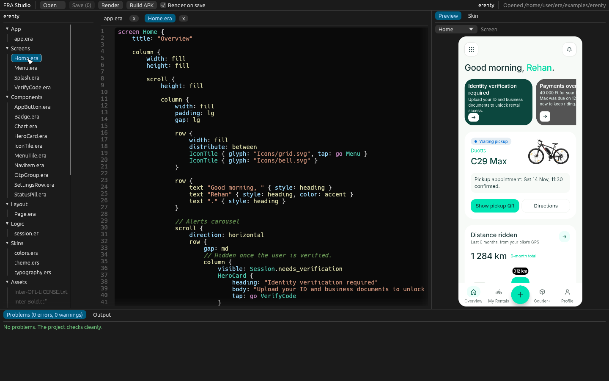
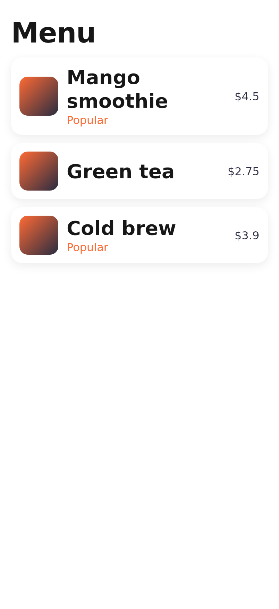

# ERA

**Build beautiful native applications with the simplicity of visual web
development and the engineering foundation of Rust.**

ERA is a design-first language and toolchain for native apps. The
compiler is written in Rust and generates native Android UI (Kotlin and
Jetpack Compose), with no WebView.

> **Status: M9.** `era new`, `era check`, `era preview`,
> `era build android` (debug, or `--release`: signed, R8-optimised APK
> and App Bundle), `era export android` (a standalone Android Studio
> project your team owns) work, and **ERA Studio** (`era-studio`) is the
> desktop editor, with live problems as you type, a real Compose preview
> and one-click APK builds. Apps support taps, state and navigation, and
> the APK has been verified on an Android phone.

**New here? Start with [Quick_start_guide.md](Quick_start_guide.md).** Prefer an editor? See [docs/STUDIO.md](docs/STUDIO.md).

Examples:
- `examples/erenty/`: the first demo, a four-screen rental app (Splash,
  Home, Menu, Verify code) built from real mockups.
- `examples/showcase/`: a compact tour of the design system, also used
  as a test fixture.
- `examples/brew/`: a small coffee-shop app showing everything together:
  a skin, a JSON data list shown with a component, saved cart state and
  two screens.

ERA's MVP follows **HTML/CSS**: `padding: 8px 16px`, `margin: 0 auto`, `width: 50%`, `position: absolute`, `justify-content: space-between`, in any spelling (`font-size`, `fontSize`, `font_size`). See `docs/CSS_SPEC.md`, and `docs/V2_SYNTAX_CHEATSHEET.md` for the v2 plan.

Data, the frontend way: `persist state` keeps values on the device, and
JSON files in `Data/` become lists you show with `for p in Products { ... }`.

See `MILESTONES.md`, `DECISIONS.md` and `docs/`.

Copyright © 2026 the ERA authors. All rights reserved. Proprietary and
confidential.
