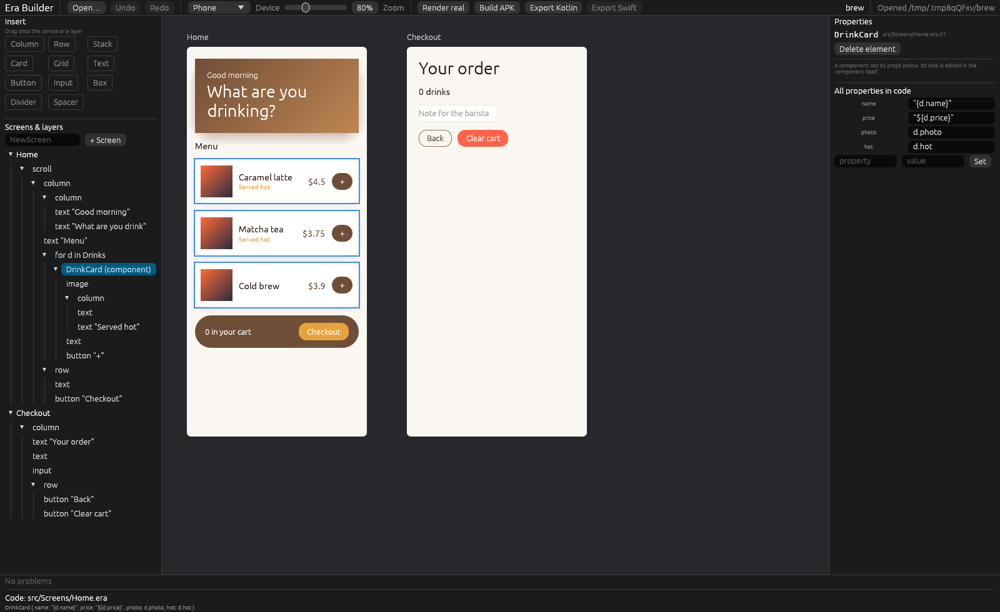

# Era Builder

Era Builder (`era-builder`) is ERA's visual app builder (D-092, D-095): a
canvas with every screen, an insert palette, layers and a properties panel,
in the spirit of Framer. Everything you do on the canvas is a small edit of
your `.era` files, saved straight away. The code stays the source of truth,
and **Export** delivers native code: Kotlin + Jetpack Compose today, SwiftUI
next (D-082).



## Run it (Mac)

```bash
cargo build --release --workspace
```

```bash
./target/release/era-builder examples/brew
```

Building the whole workspace puts `era` next to `era-builder`, which the
Render, Build APK and Export buttons use (or set `ERA_BIN`).

## The window

| Area | What it does |
|---|---|
| **Insert** (left, top) | Drag Column, Row, Stack, Card, Grid, Text, Button, Input, Box, Divider or Spacer onto a container on the canvas, or onto a layer |
| **Screens & layers** (left) | Every screen's element tree. Click to select. Drag a layer onto another to move it: the top or bottom part of a row puts it before or after, the middle of a container puts it inside. **+ Screen** adds `src/Screens/<Name>.era` |
| **Canvas** (centre) | Every screen side by side, start screen first. Click to select, drag a selected element onto a container to move it. Scroll to pan, pinch or Cmd+scroll to zoom. Drag empty space to pan |
| **Properties** (right) | Content (text and button labels), Layout, Style, Text and Interaction fields written the CSS way (`padding: 8px 16px`, `border-radius: 50%`), colour pickers, and every property already in the code, all editable. A component use shows its props |
| **Bottom** | Problems, the selected element's code, and job output |
| **Toolbar** | Undo/Redo (Cmd+Z, Cmd+Shift+Z), device size, zoom, **Render real** (exact Compose render), **Build APK**, **Export Kotlin** (`era export android`), Export Swift (planned) |

Delete or Backspace deletes the selected element.

## How it works

- `crates/era_canvas` lays out the UI IR with Taffy (CSS flexbox and grid,
  D-095), with `for` lists expanded from `Data/*.json` and state shown at
  its initial values.
- `crates/era_builder/src/edit.rs` turns every action into a minimal text
  edit (set, add or remove a property in any spelling, change a label,
  insert, delete, move), so comments and formatting are kept.
- Every IR element carries its source location (`SourceRef`). A component
  use points at the use; elements inside a component point at the
  component's file, and the panel warns that edits change every use.

## Limits (first version)

- The canvas is an editor preview: one font, no bold or italic, icons are
  placeholders, gradients ignore rounded corners, and filters and outlines
  are not drawn. **Render real** shows the exact Compose output.
- Moving elements works within one file.
- No resize handles or inline text editing on the canvas yet (edit sizes
  and labels in Properties).
- SwiftUI export is not built yet (D-082).

## Tests

`cargo test -p era_builder` drives the real window headlessly. To refresh
the screenshot (needs a GPU, or lavapipe on Linux):

```bash
VK_ICD_FILENAMES=/opt/lavapipe/lvp_icd.json cargo test -p era_builder -- --ignored
```
