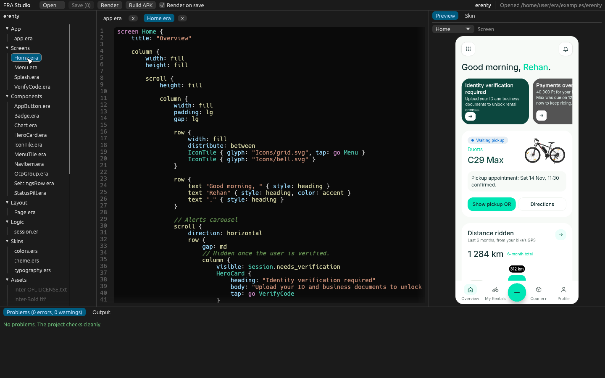

# ERA Studio

ERA Studio is the desktop editor for ERA projects. It is written in Rust
with egui/eframe and runs natively on macOS (Apple Silicon, using Metal),
Linux and Windows.



## Install and run

```bash
cargo install --path crates/era_cli
```

```bash
cargo install --path crates/era_studio
```

```bash
era-studio examples/erenty
```

Studio needs the `era` command for **Render** and **Build APK**. It looks
for it in this order: the `ERA_BIN` environment variable, an `era` next to
`era-studio`, then `era` on your `PATH`. Installing both crates as shown
covers that. Run `era-studio` with no argument to get the welcome screen,
with **Open project…** (a native folder picker) and **New project**.

## What it does

| Area | What you get |
|---|---|
| **Project tree** (left) | Files grouped as App, Screens, Components, Layout, Logic, Skins, Assets and Project. Files with errors are red, and unsaved files show `*` |
| **Editor** (centre) | Tabs, line numbers, and ERA syntax colouring from ERA's own lexer. Colour literals like `#FF6B35` are shown on a swatch of that colour, and invalid input is underlined |
| **Problems** (bottom) | ERA's full check (syntax, structure, skins, properties, components, assets, stores) runs **as you type**, on unsaved text, about 250 ms after you stop typing. Click a problem to jump to it. "Did you mean" hints are shown inline |
| **Output** (bottom) | The live log of Render and Build APK runs |
| **Preview** (right) | The real Compose render of each screen from `era preview --png`. It follows the screen you are editing, and has a dark-mode toggle when the skin has dark colours |
| **Skin** (right) | The resolved skin: colour swatches, spacing, radius, elevation and text styles |

| Action | Shortcut | Notes |
|---|---|---|
| Save all | Cmd+S (Ctrl+S on Linux/Windows) | Re-renders the preview afterwards when **Render on save** is on and there are no errors |
| Render | Cmd+R | Saves first. The first render downloads Kotlin and Compose (a minute or two) |
| Build APK | toolbar | Runs `era build android` and needs `ANDROID_HOME`. The APK path is printed in Output |

## How it works

- Studio calls ERA's check pipeline in-process (`era_ir::pipeline`, the
  same code as `era check`). Unsaved buffers are passed in place of the
  files on disk, so problems update instantly without saving.
- Render and Build APK run the `era` CLI in a background thread and
  stream its output, so the editor never freezes.
- Code lives in `crates/era_studio`. The UI (`app.rs`) is a thin layer
  over `workspace.rs` (project, buffers, problems), `highlight.rs`
  (colouring) and `jobs.rs` (background runs), all of which have tests.

## Tests

```bash
cargo test -p era_studio
```

This includes headless UI tests (egui_kittest) that drive the real window:

- the welcome screen
- opening a project
- typing an error and clicking the problem
- tree navigation, with the preview following the screen
- accessibility names on every widget

Rendering a screenshot of the window needs a GPU driver. On a Mac this
works as is:

```bash
cargo test -p era_studio -- --ignored
```

That writes `target/era-studio-screenshot.png`. On Linux without a GPU,
set `VK_ICD_FILENAMES` to a software Vulkan driver such as lavapipe.

## Limits (first version)

- No undo across tabs, no find/replace, no autocomplete, no go-to-definition.
- The preview refreshes on render, not on every keystroke (no hot reload).
- No visual drag-and-drop editing (D-065 chose the code editor first).
- No `.app` bundle or icon yet. Run it with `era-studio` from a terminal.
